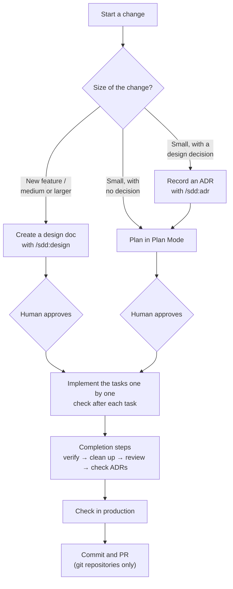

# How to use sdd (decision criteria)

This file is the canonical source of the decision criteria that sdd uses for guidance. `/sdd:ask` reads it to guide you. You can read it too.

## Overall flow

## 0. Prerequisites and setup

Make sure the project has the following three items. If not, set them up.

| Required | Role |
|---|---|
| `CLAUDE.md` | Project overview, commands, development flow, and conventions |
| `docs/design/` | Where design docs live |
| `docs/adr/` | Where ADRs (decision records) live |

**Setup steps**
1. Start Claude Code at the project root.
2. A human runs `/sdd:init`.
3. Claude proposes a CLAUDE.md (or, if one exists, a diff to append) and the creation of `docs/design/` and `docs/adr/` (including ADR `0001`).
4. Review the proposal and approve it. Approving writes the files. Nothing is committed.
5. Check that the "Common commands" section of CLAUDE.md lists the test, lint, and run commands. Later steps use them.

## 1. Decide the size of the change

Before starting a change, choose a category from this table. When in doubt, choose the lower category, and move up when needed (see 2-C and 2-D).

| Category | Guideline | How to proceed |
|---|---|---|
| A. New feature / medium or larger | Multiple files, a new command or feature, or requirements that need sorting out | Step 2-A |
| B. Small, with a design decision | About one file, but includes a technology choice, a change in format or structure, or a decision with trade-offs | Step 2-B |
| C. Small, with no decision | About one file, simply fixing things along existing policy (bug fixes, wording fixes, and so on) | Step 2-C |

A "design decision" is a choice someone may later ask "why did we do it this way?" about. A missed ADR is caught by the ADR check in `/sdd:ship`.

## 2. Steps for each category

### 2-A. New feature / medium or larger

1. Enter Plan Mode (switch with Shift+Tab).
2. A human runs `/sdd:design <feature name or summary>`.
3. Answer Claude's questions one at a time.
4. Review the design doc Claude proposes. Check that it has requirements (REQ-n), non-goals, implementation tasks (Tn), and verification methods.
5. Approve it. It is saved as `docs/design/YYYY-MM-<slug>.md` with Status: Approved.
6. If Claude proposes recording an ADR, create it the same way as steps 1–3 of 2-B.
7. Go to step 2-D.

### 2-B. Small, with a design decision

1. Have Claude run `/sdd:adr <decision title>` (a human may type it instead).
2. Review the ADR draft Claude shows. Check that it has Context, Decision, and Consequences, and that it doesn't contradict existing ADRs.
3. Approve it. It is saved as `docs/adr/NNNN-<slug>.md`.
4. Go to step 2-C.

### 2-C. Small, with no decision (including the continuation of 2-B)

1. Enter Plan Mode.
2. Tell Claude what to change and have it make a plan. The plan should include the files to change, the steps, and how to verify.
   - If a design decision comes up while planning, record it with `/sdd:adr` first (move up to B). If the requirements turn out to need sorting out, or it becomes a new feature, switch to `/sdd:design` (move up to A).
3. Review and approve the plan.
4. Go to step 2-D.

### 2-D. Implementation

1. Have Claude implement the implementation tasks of the design doc (for 2-A) or the steps of the plan (for 2-B and 2-C) one at a time, from the top.
2. After each task, run the tests and lint listed in "Common commands" of CLAUDE.md to check it.
3. If a new design decision comes up during implementation, run `/sdd:adr` at that point.
4. If a change would go against an ADR whose Status is Accepted, stop implementing. Have Claude propose a new ADR that marks the existing ADR as Superseded, and continue only after approval.
5. When all tasks are done, go to step 3.

## 3. Completion steps

Run these from the top. Steps 3-1 to 3-5 run together when you have Claude run `/sdd:ship`. You may also run them one at a time. If you need to check the app's behavior, you can also use the bundled `/verify` skill in 3-1.

`/sdd:ship` first declares the category in one line and scales the steps. A: all steps. B: 3-1 checks only consistency with ADRs, and 3-3 runs only when the diff adds or changes logic. C: skips 3-1 and 3-3, and runs 3-4 as `/code-review low`. The category comes from the design doc (A) or an ADR added on the branch (B), and is raised if the diff touches configuration, public APIs, dependencies, security, or places your CLAUDE.md lists. To override it, run `/sdd:ship <A|B|C>`. The rules are in ship's `SKILL.md`.

| # | Step | What to run | What to check |
|---|---|---|---|
| 3-1 | Match requirements against the implementation | sdd:verifier subagent (started by `/sdd:ship`) | Each requirement is judged "met" |
| 3-2 | Tests, lint, type checks | "Common commands" in CLAUDE.md | Everything passes |
| 3-3 | Clean up the code | `/simplify` | The response to each finding (fixed / skipped) is reported |
| 3-4 | Check for bugs | `/code-review` | No findings, or all fixed |
| 3-5 | Check for missing ADRs and update docs | Have Claude check | No decision that should be an ADR is left. The design doc's task checkboxes and Status (Implemented) are updated |
| 3-6 | Check in production | Run by a human | It works as expected in the production environment with production data |
| 3-7 | Commit and PR | Last step of `/sdd:ship` | Review the changes before approving |

- 3-3 and 3-4 may rewrite code, so finish them before 3-6. Check in production only after all code fixes are done.
- `/sdd:ship` runs up to 3-5, then shows the changes and commits and creates the PR (3-7) after approval. If you do 3-6, finish it before approving.
- 3-6 includes operations that are hard to undo, such as writing to production or publishing externally. A human runs those commands in their own terminal.
- If 3-3 or 3-4 rewrote anything, run 3-2 again.

## 4. Differences by environment and situation

| Situation | Affected step | How |
|---|---|---|
| Directory not under git | 3-3, 3-4 | No diff is available, so specify targets, like `/simplify <file path>` and `/code-review <file path>` |
| Directory not under git | 3-7 | No commit or PR. If you use `/sdd:ship`, stop after 3-1 to 3-5 |
| No design doc (2-B, 2-C) | 3-1 | B checks only consistency with ADRs, and C skips it. If raised to A, sdd:verifier uses the Plan Mode plan file (by default in `~/.claude/plans/`) as the requirements |
| No design doc (2-B, 2-C) | 3-5 | There are no task checkboxes or Status to update. Instead, check that related docs (README or module descriptions) are updated |
| No automated tests | 2-D, 3-2 | Use the alternative checks written in CLAUDE.md (syntax checks, self-tests, and so on) |

## 5. Command list

| Command | Purpose | Who can start it | Used in step |
|---|---|---|---|
| `/sdd:ask` | Entry point when you're unsure which skill to use (guidance only; it doesn't run skills) | Human, Claude | All |
| `/sdd:init` | Set up a project | Human only | 0 |
| `/sdd:design` | Create a design doc (run in Plan Mode) | Human only | 2-A |
| `/sdd:adr` | Record an ADR | Human, Claude | 2-A, 2-B, 2-D |
| `/sdd:ship` | Run the completion steps together | Human, Claude | 3 |
| `/simplify` | Clean up the code (bundled with Claude Code) | Human, Claude | 3-3 |
| `/code-review` | Check for bugs (bundled with Claude Code) | Human, Claude | 3-4 |
| Plan Mode | Create and approve a plan (switch with Shift+Tab) | Human | 2-A, 2-C |

"Human only" commands have `disable-model-invocation: true` in their `SKILL.md`. Claude can't start them, so when Claude points you to one, a human types it.

## 6. Determining where you are

`/sdd:ask` determines where you are and the next step from the following table and the request text. It doesn't guess what it can't determine; it asks one question at a time.

### Decide from the state

Apply the rows from the top.

| State | Where you are | Next step |
|---|---|---|
| Any of CLAUDE.md, `docs/design/`, or `docs/adr/` is missing | Before setup | 0 (`/sdd:init`) |
| There is a design doc whose Status is Approved | Implementing / before completion | If all tasks are checked, 3 (`/sdd:ship`). If unchecked tasks remain, ask how far you've gotten (implementing → 2-D / implementation finished → 3). Tasks are checked in 3-5, so implementation may be finished even with unchecked tasks |
| No Approved design doc, and there is a diff (uncommitted changes or commits not on the default branch). Or not under git, and the user answered that work is in progress | Work in progress (continuing 2-B or 2-C) | Ask how far you've gotten (no plan yet → 2-C / implementing → 2-D / implementation finished → 3) |
| No Approved design doc and no diff. Or not under git, and the user answered that work hasn't started | Before starting | 1 (decide the size) |

- When there are multiple design docs whose Status is Approved, list them and ask which one is the target.
- In a directory not under git, no diff is available, so if there is no Approved design doc, ask whether work is in progress or hasn't started.
- "Designing" (partway through `/sdd:design` in Plan Mode) isn't determined from the state, because `/sdd:design` saves the file only after approval.

### Use the request text

- Before starting: if there is request text, use it to decide the category in 1. If not, tell the user to call again with `/sdd:ask <what you want to do>`.
- Otherwise (except before setup): if the request continues the current work, point to the part of the next step that fits the request (for example, a design decision came up during implementation → 3 of 2-D (`/sdd:adr`); want to create a PR → 3 (`/sdd:ship`)). If it's a different change, say that the current work remains, then decide the category in 1.
