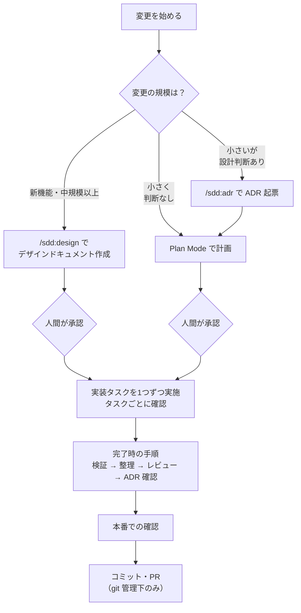

# sdd の使い方（判断基準）

このファイルは sdd の案内の判断基準の正本です。`/sdd:ask` が読んで案内に使います。人間が読んでもかまいません。

## 全体の流れ

## 0. 前提と導入

プロジェクトに次の3つがあることを確認します。無ければ導入します。

| 必要なもの | 役割 |
|---|---|
| `CLAUDE.md` | プロジェクトの概要・コマンド・開発フロー・規約 |
| `docs/design/` | デザインドキュメントの置き場所 |
| `docs/adr/` | ADR（判断記録）の置き場所 |

**導入手順**
1. プロジェクトのルートで Claude Code を起動する。
2. 人間が `/sdd:init` を実行する。
3. Claude が CLAUDE.md の案（既にあれば追記の差分案）と、`docs/design/`・`docs/adr/`（`0001` の ADR を含む）の作成案を示す。
4. 内容を確認して承認する。承認すると書き込まれる。コミットはされない。
5. CLAUDE.md の「よく使うコマンド」に、テスト・Lint・起動のコマンドが書かれていることを確認する。後の手順で使う。

## 1. 変更の規模を判定する

変更を始める前に、次の表で区分を決めます。迷ったら、上の区分を選びます。

| 区分 | 目安 | 進め方 |
|---|---|---|
| A. 新機能・中規模以上 | 複数ファイル・新しいコマンドや機能・要件の整理が要る | 手順 2-A |
| B. 小さいが設計判断あり | 1ファイル程度。ただし、技術選定・書式や構造の変更・トレードオフのある判断を含む | 手順 2-B |
| C. 小さく判断なし | 1ファイル程度で、既存の方針どおりに直すだけ（不具合修正・文言修正など） | 手順 2-C |

「設計判断」とは、後から「なぜこうしたのか」を問われうる選択のことです。迷ったら B にして ADR を残します。

## 2. 区分ごとの手順

### 2-A. 新機能・中規模以上

1. Plan Mode に入る（Shift+Tab で切り替える）。
2. 人間が `/sdd:design <機能名や概要>` を実行する。
3. Claude の質問に1問ずつ答える。
4. Claude が示すデザインドキュメントの案を確認する。要件（REQ-n）・やらないこと・実装タスク（Tn）・検証方法が揃っているかを見る。
5. 承認する。`docs/design/YYYY-MM-<slug>.md` に Status: Approved で保存される。
6. Claude が ADR の起票を提案したら、手順 2-B の 1〜3 と同じ要領で ADR を作る。
7. 手順 2-D に進む。

### 2-B. 小さいが設計判断あり

1. Claude に `/sdd:adr <判断のタイトル>` を実行させる（人間が入力してもよい）。
2. Claude が示す ADR の下書きを確認する。Context（背景）・Decision（決定）・Consequences（結果）が書かれているか、既存の ADR と矛盾していないかを見る。
3. 承認する。`docs/adr/NNNN-<slug>.md` に保存される。
4. 手順 2-C に進む。

### 2-C. 小さく判断なし（2-B の続きを含む）

1. Plan Mode に入る。
2. 変更の内容を Claude に伝え、計画を作らせる。計画には、変更するファイル・手順・検証方法を含めさせる。
3. 計画を確認して承認する。
4. 手順 2-D に進む。

### 2-D. 実装

1. デザインドキュメントの実装タスク（2-A の場合）か、計画の手順（2-B・2-C の場合）を、上から1つずつ実装させる。
2. タスクを1つ終えるごとに、CLAUDE.md の「よく使うコマンド」にあるテスト・Lint を実行して確認する。
3. 実装中に新しい設計判断が出てきたら、その時点で `/sdd:adr` を実行する。
4. Status が Accepted の ADR に反する変更が必要になったら、実装を止める。新しい ADR で既存の ADR を Superseded にする提案をさせ、承認を得てから進める。
5. すべてのタスクが終わったら、手順 3 に進む。

## 3. 完了時の手順

上から順に実行します。手順 3-1〜3-5 は Claude に `/sdd:ship` を実行させればまとめて進みます。1つずつ実行してもかまいません。アプリの動作確認が必要なら、3-1 で同梱スキル `/verify` も使えます。

| # | 手順 | 実行するもの | 確認すること |
|---|---|---|---|
| 3-1 | 要件と実装の突き合わせ | sdd:verifier サブエージェント（`/sdd:ship` が起動） | 要件ごとに「満たす」と判定されている |
| 3-2 | テスト・Lint・型チェック | CLAUDE.md の「よく使うコマンド」 | すべて通る |
| 3-3 | コードの整理 | `/simplify` | 指摘への対応（修正 / 見送り）が報告されている |
| 3-4 | バグの確認 | `/code-review` | 指摘が無いか、修正済み |
| 3-5 | ADR の漏れ確認とドキュメント更新 | Claude に確認させる | ADR にすべき判断が残っていない。デザインドキュメントのタスクのチェックと Status（Implemented）が更新されている |
| 3-6 | 本番での確認 | 人間が実行 | 本番環境・本番データで期待どおりに動く |
| 3-7 | コミット・PR | `/sdd:ship` の最後の手順 | 変更内容を確認してから承認する |

- 3-3・3-4 はコードを書き換えることがあるので、3-6 より前に済ませます。本番での確認は、コードの修正がすべて終わってから行います。
- `/sdd:ship` は、3-5 まで進めたあと、変更内容を提示して承認を得てからコミットと PR 作成（3-7）を行います。3-6 を行う場合は、承認の前に済ませてください。
- 3-6 は、本番に書き込む・外部に公開するなど、取り消しにくい操作を含みます。コマンドは人間が自分の端末で実行します。
- 3-3・3-4 で書き換えが入ったら、3-2 をもう一度実行します。

## 4. 環境・状況ごとの違い

| 状況 | 変わる手順 | やり方 |
|---|---|---|
| git 管理外のディレクトリ | 3-3・3-4 | 差分が取れないので、`/simplify <ファイルパス>`・`/code-review <ファイルパス>` のように対象を指定する |
| git 管理外のディレクトリ | 3-7 | コミット・PR は行わない。`/sdd:ship` を使う場合は、3-1〜3-5 で止める |
| デザインドキュメントが無い（2-B・2-C） | 3-1 | sdd:verifier には、ADR のファイルと Plan Mode の計画ファイル（既定では `~/.claude/plans/`。設定の `plansDirectory` で変わる）を要件として渡す |
| デザインドキュメントが無い（2-B・2-C） | 3-5 | タスクのチェックと Status の更新は無い。代わりに、関連するドキュメント（README やモジュールの説明）が更新されているかを確認する |
| 自動テストが無い | 2-D・3-2 | CLAUDE.md に書かれた代わりの確認方法（構文チェック・セルフテストなど）を使う |

## 5. コマンド一覧

| コマンド | 用途 | 起動できる人 | 使う手順 |
|---|---|---|---|
| `/sdd:ask` | どのスキルを使うか迷ったときの窓口（案内だけで、スキルは実行しない） | 人間・Claude | すべて |
| `/sdd:init` | プロジェクトへの導入 | 人間のみ | 0 |
| `/sdd:design` | デザインドキュメント作成（Plan Mode で実行） | 人間のみ | 2-A |
| `/sdd:adr` | ADR 起票 | 人間・Claude | 2-A, 2-B, 2-D |
| `/sdd:ship` | 完了時の手順の一括実行 | 人間・Claude | 3 |
| `/simplify` | コードの整理（Claude Code 同梱） | 人間・Claude | 3-3 |
| `/code-review` | バグの確認（Claude Code 同梱） | 人間・Claude | 3-4 |
| Plan Mode | 計画の作成と承認（Shift+Tab で切り替え） | 人間 | 2-A, 2-C |

「人間のみ」のコマンドは、`SKILL.md` で `disable-model-invocation: true` になっています。Claude からは起動できないので、Claude が案内したら人間が入力します。

## 6. 現在地の判定

`/sdd:ask` は、次の表と依頼文から、現在地と次の手順を決めます。判定できないことは推測せず、1問ずつ聞きます。

### 状態から決める

上の行から順に当てはめます。

| 状態 | 現在地 | 次の手順 |
|---|---|---|
| CLAUDE.md・`docs/design/`・`docs/adr/` のどれかが無い | 導入前 | 0（`/sdd:init`） |
| Status が Approved のデザインドキュメントがある | 実装中／完了前 | タスクがすべてチェック済みなら 3（`/sdd:ship`）。未チェックが残っていれば、どこまで進んだかを聞く（実装中 → 2-D／実装が終わった → 3）。タスクのチェックは 3-5 で付けるため、未チェックでも実装が終わっていることがある |
| Approved のデザインドキュメントが無く、差分（未コミットの変更か、デフォルトブランチに無いコミット）がある。または git 管理外で、作業中だと答えた | 作業中（2-B・2-C の続き） | どこまで進んだかを聞く（計画がまだ → 2-C／実装中 → 2-D／実装が終わった → 3） |
| Approved のデザインドキュメントが無く、差分も無い。または git 管理外で、まだ始めていないと答えた | 着手前 | 1（規模の判定） |

- Status が Approved のデザインドキュメントが複数あるときは、一覧を示して、どれを対象にするかを聞きます。
- git 管理外のディレクトリでは差分が取れないので、Approved のデザインドキュメントが無ければ、作業中かまだ始めていないかを聞きます。
- 「設計中」（Plan Mode で `/sdd:design` を進めている途中）は、状態からは判定しません。`/sdd:design` は承認されてから初めてファイルを保存するためです。

### 依頼文を使う

- 着手前: 依頼文があれば、そこから 1 の区分を判定します。無ければ、`/sdd:ask <やりたいこと>` で呼び直すよう案内します。
- それ以外（導入前を除く）: 依頼が今の作業の続きなら、次の手順のうち依頼に合う段を案内します（例: 実装中に設計判断が出てきた → 2-D の 3（`/sdd:adr`）、PR を作りたい → 3（`/sdd:ship`））。別の変更なら、今の作業が残っていることを伝えたうえで、1 の区分を判定します。
